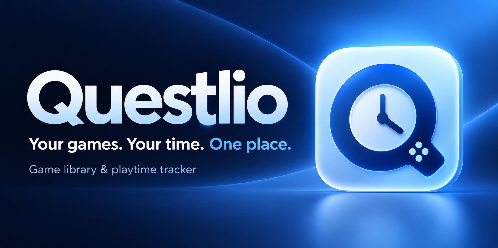
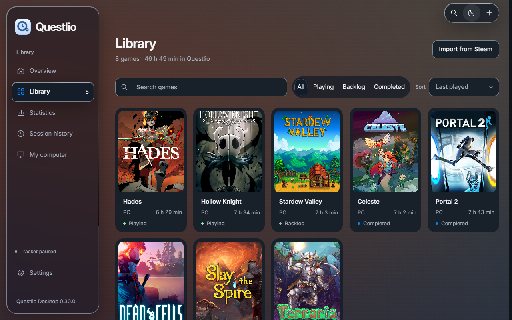
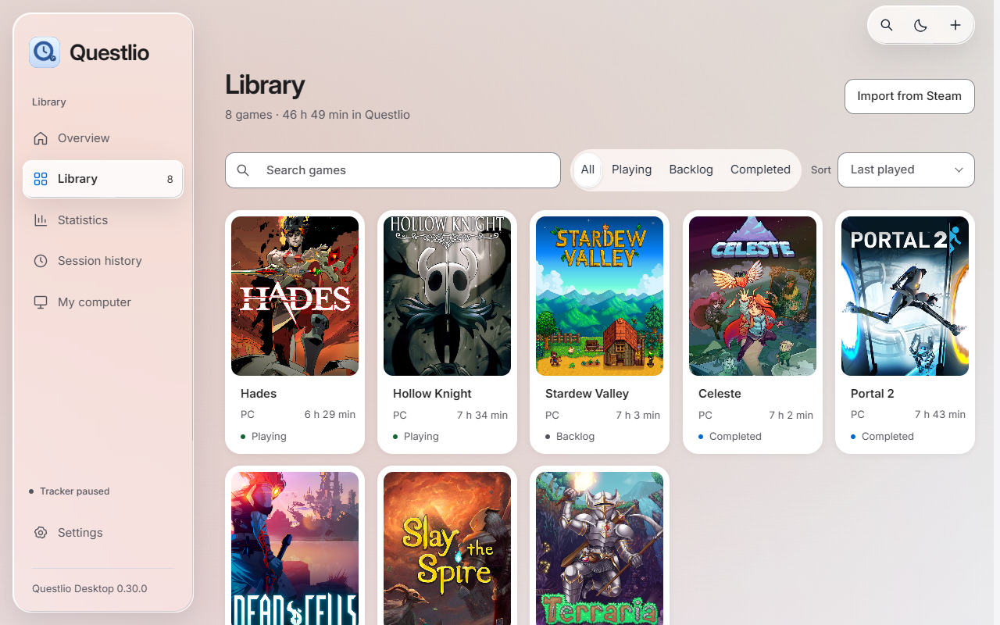
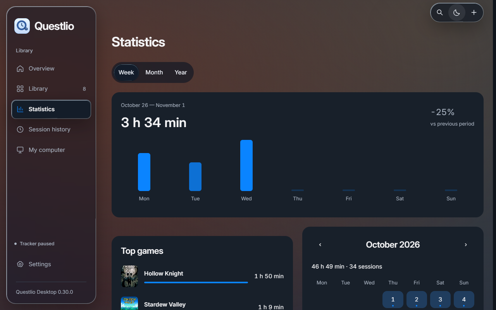
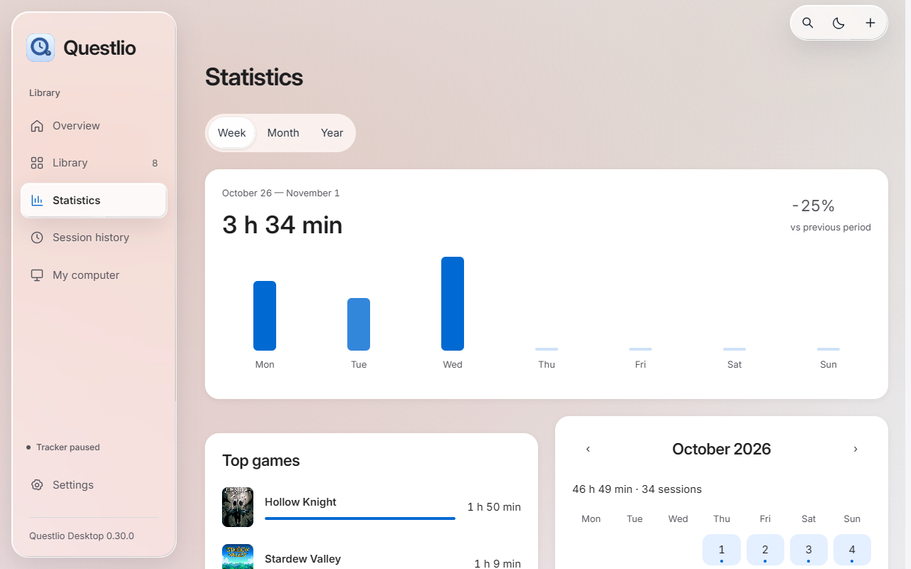

<p align="center"></p>

<h1 align="center">Questlio</h1>
<p align="center"><b>Your games. Your time. One place.</b><br />A local-first Windows game library and playtime tracker.<br /><sub>By <a href="https://github.com/StokeleyDev">StokeleyDev</a></sub></p>

<p align="center"><a href="https://github.com/StokeleyDev/Questlio/releases/latest"><b>Download for Windows</b></a> · <a href="#quick-start">Quick start</a> · <a href="#actual-interface">Screenshots</a></p>

## A home for your gaming history

Keep your PC games together, record sessions, and see how your playtime adds up. Questlio combines a game library, session history and statistics in a desktop interface with light and dark themes and glass controls.

Your library starts empty. Add your own games or import a Steam library, then keep Questlio running to track supported game processes.

## Inside Questlio

| Screen or feature | What it does |
| :--- | :--- |
| Overview | Recent games, local playtime totals and activity |
| Library | Search games, change their status and edit notes |
| Game details | Bind executable files, choose cover art and review playtime |
| Statistics | Explore activity by period and calendar |
| Session history | Browse recorded sessions |
| My computer | View hardware information detected by Windows |
| Steam import | Import game records and Steam playtime; profile visibility and an API key may be required |
| Emulator tracking | Configure emulator executables and detect ROMs from launch arguments |
| Backups | Create and restore copies of the local library |
| Appearance and language | English/Russian, light/dark/automatic theme, reduced motion and transparency |

## Quick start

**Windows 10 or 11, 64-bit.** The portable release includes the .NET runtime. Microsoft Edge WebView2 Runtime must be installed.

1. Download [Questlio 0.30.0 portable ZIP](https://github.com/StokeleyDev/Questlio/releases/download/v0.30.0/Questlio-0.30.0-win-x64-portable.zip), or use the [latest release](https://github.com/StokeleyDev/Questlio/releases/latest).
2. Extract the **entire** archive into a folder on your PC.
3. Open the extracted `Questlio` folder and run **`Questlio.exe`**.
4. Choose **Add game** and select a game executable, or use **Import from Steam**.

Keep the launcher and its `desktop` folder together. Do not run the application directly inside the ZIP. If the interface cannot open, install [Microsoft Edge WebView2 Runtime](https://developer.microsoft.com/en-us/microsoft-edge/webview2/).

English is the default language. Select **Settings → Language → Русский** to switch to Russian; the choice is saved.

## Tracking your games

Questlio needs to remain running, including in the system tray, to record new sessions. An imported Steam record alone does not guarantee process detection: link the game's EXE when necessary. Existing Steam hours are stored separately from local tracking history; importing them does not create historical sessions.

Emulator detection uses command-line arguments. A ROM launched entirely from an emulator's internal menu may not be identifiable. Idle-time handling can be configured in Settings.

## Your data stays on your PC

The library, preferences, cached covers and backups are stored under:

```text
%LOCALAPPDATA%\Questlio
```

The portable folder contains the program, while your library lives in that separate user-data folder. Removing or replacing program files does not automatically erase your library. Back up your data before changing PCs or restoring a database.

Steam requests and cover downloads use the internet when those features are used. The Steam API key is used for the request and is not saved by the import interface. Personal databases, user profiles and local logs are not included in this repository or portable release.

## Actual interface

**Dark theme**



**Light theme**



**Statistics — dark theme**



**Statistics — light theme**



These are real application screenshots using eight demo games and synthetic play sessions. No personal library or activity is shown; the download still starts with an empty library. Game artwork belongs to its respective owners. The cover above is an AI-generated brand illustration, not a screenshot.

## Build from source

Install the **.NET 8 SDK** on Windows, then run:

```powershell
git clone https://github.com/StokeleyDev/Questlio.git
cd Questlio\desktop
.\build.ps1
```

The build publishes `desktop/release-0.30.0`, updates `desktop/latest.txt`, and creates the root `Questlio.exe` launcher. NuGet access is needed to restore dependencies on a new development machine.

## Built with

**C# / .NET 8 · WinForms · WebView2 · SQLite · HTML / CSS / JavaScript**

- `desktop/Program.cs` — native window, tray and WebView bridge.
- `desktop/LibraryStore.cs` — local library storage.
- `desktop/Tracker.cs` — session tracking.
- `desktop/ui/` — interface, components and English/Russian localization.
- `desktop/ui/fonts/OFL.txt` — bundled Inter font license.

## Feedback

Found a bug or have an idea? [Open an issue](https://github.com/StokeleyDev/Questlio/issues). Include the app version, Windows version and steps to reproduce. Avoid posting your database, Steam key or logs containing personal file paths.
